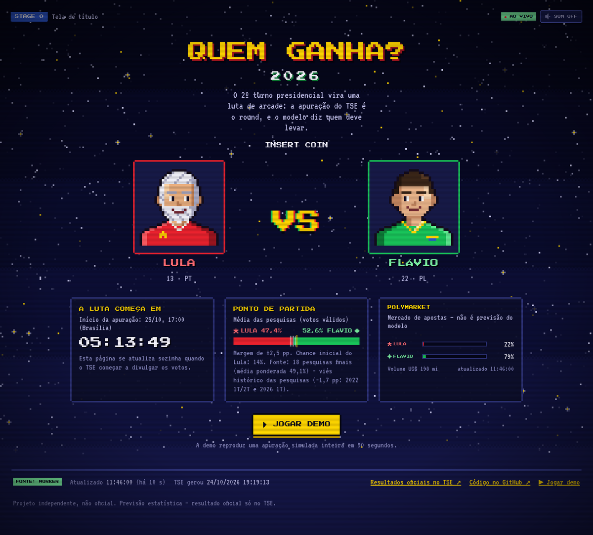
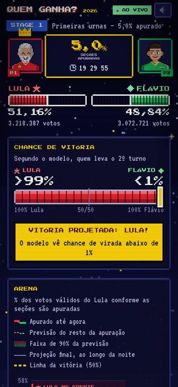
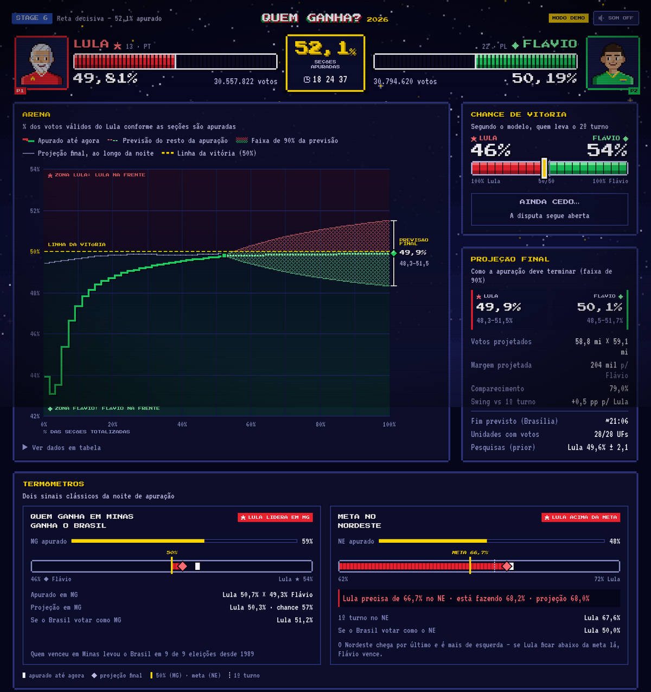
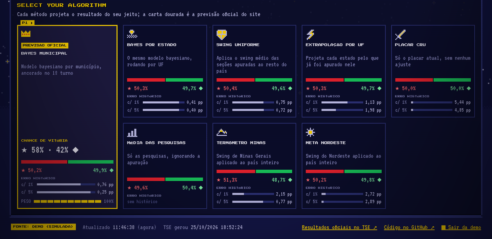
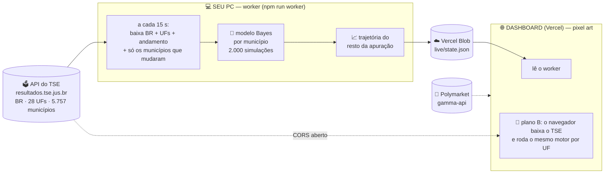

<p align="center">
  
</p>

<p align="center">
  <a href="https://quem-ganha.vercel.app"></a>
</p>

<p align="center">
  
  
  
  
  
</p>

<p align="center"><b>🕹️ Uma previsão estatística AO VIVO do 2º turno presidencial de 2026 — Lula (PT) × Flávio Bolsonaro (PL) — que tenta cravar o vencedor com <u>1% das urnas apuradas</u>, num dashboard que parece um jogo de luta 16-bit.</b></p>

```
 ╔══════════════════════════════════════════════════════════════════════╗
 ║  P1 LULA  ▓▓▓▓▓▓▓▓▓▓▓▓░░░░░░░░   VS   ░░░░░░░░▓▓▓▓▓▓▓▓▓▓▓▓  FLÁVIO P2  ║
 ║                                                                      ║
 ║   17:00 ▸ urnas fecham    17:13 ▸ 1% apurado    ~20:30 ▸ 100%        ║
 ║                                                                      ║
 ║   O placar da TV MENTE no começo: o Sul chega primeiro, o Nordeste   ║
 ║   por último. Em 2022 Bolsonaro "liderou" até 68% — e perdeu.        ║
 ║   Este projeto corrige isso em tempo real.          INSERT COIN ▮    ║
 ╚══════════════════════════════════════════════════════════════════════╝
```

## 🎮 GAMEPLAY

<table>
<tr>
<td width="72%"></td>
<td width="28%" rowspan="2"></td>
</tr>
<tr><td><sub><b>STAGE 0 — tela de título.</b> Contagem regressiva, prior das pesquisas e a cotação do Polymarket ao vivo. <b>JOGAR DEMO</b> simula uma apuração inteira em 90 s.</sub></td></tr>
</table>

<p align="center"></p>
<p align="center"><sub><b>A ARENA.</b> Barras de vida = votos apurados · linha cheia = apuração até agora · faixa pontilhada = <b>previsão de como o resto da apuração vai se comportar</b> · medidor de chance de vitória · termômetros de Minas e do Nordeste.</sub></p>

<p align="center"></p>
<p align="center"><sub><b>SELECT YOUR ALGORITHM.</b> Cada "personagem" é um método de previsão, com a <b>barra de erro histórico</b> medida no backtest. A carta dourada é a previsão oficial.</sub></p>


| | 🟥 **PLAYER 1** | 🟩 **PLAYER 2** |
|---|:---:|:---:|
| **Lutador** | **LULA** (PT · nº 13) | **FLÁVIO BOLSONARO** (PL · nº 22) |
| **Cor** | vermelho `#e8222e` | verde `#19c35a` |
| **1º turno (04/10)** | 53.879.538 votos · 45,16% | 56.104.503 votos · **47,03%** |
| **Base forte** | Nordeste (BA 70%, PI 75% entre os dois) | Sul e Centro-Oeste (SC 73%, RO 72%) |
| **Pesquisas finais** (média de 18) | 49,1% dos válidos | 50,9% dos válidos |
| **Polymarket** (manhã de 25/10) | ~21% | ~79% |
| **Golpe especial** | chega forte no fim da apuração (NE) | larga na frente (Sul/SP) |




1. **17:00** — urnas fecham, os primeiros boletins chegam ao TSE (o exterior primeiro).
2. O **worker** (rodando no seu computador) consulta a API pública do TSE a cada 15 s. Ele baixa só os municípios que mudaram, compara cada um com o **1º turno no mesmo município** e roda o modelo.
3. O resultado vai para o **Vercel Blob**, e o **dashboard** público desenha tudo como um jogo de luta.
4. Se o worker cair, o próprio **navegador** baixa os totais do TSE (a API tem CORS aberto) e roda o mesmo motor por estado. O site nunca fica sem previsão.
5. No canto, a cotação do **Polymarket** ao vivo, para comparar a "sabedoria do mercado" com a estatística.


> 📖 Versão completa: **[docs/METODOLOGIA.md](docs/METODOLOGIA.md)** · pesquisa de métodos e pesquisas eleitorais: **[docs/PESQUISA.md](docs/PESQUISA.md)**

**O truque:** não importa *quem* está na frente no placar, e sim **quanto cada lado melhorou em relação ao 1º turno nos lugares que já apuraram**. Se Flávio caiu 2 pontos em Chapecó em relação a 04/10, isso vale para estimar o que ainda falta, mesmo que Chapecó tenha chegado cedo.

```
logit(y_município) = logit(base_1ºturno) + δ_nacional + β·[outros, tamanho, inclinação] + u_UF + ε_local
                     └────── prior ─────┘   └─ aprendido AO VIVO com os municípios que já apuraram ─┘
```

| ⚡ POWER-UP | o que faz |
|---|---|
| 🎯 **Swing logístico por município** | compara cada um dos 5.757 municípios (186 no exterior) com ele mesmo no 1º turno |
| 🧬 **Hierarquia bayesiana** | estados têm swing próprio, encolhido para o nacional quando há poucos dados |
| 🧪 **Regressão ecológica ao vivo** | aprende se municípios com mais votos de Cury/Caiado/Renan, cidades grandes ou redutos se movem diferente |
| 🔀 **Transferência de votos** | baseline usa α = 41%: a fatia declarada dos eleitores dos eliminados que vai para Lula |
| 🧲 **Prior de pesquisas corrigido** | média de 18 pesquisas (49,1%) menos o viés histórico das pesquisas contra o PT (−1,7 pp) = 47,4% ± 2,5 |
| 🌪️ **Choques de ordem de apuração** | o que falta chegar é diferente do que chegou: incerteza extra só sobre os votos restantes |
| 🗳️ **Modelo de comparecimento** | votos válidos esperados por eleitor ainda não apurado, local × regional |
| 🎲 **Monte Carlo** | 2.000 cenários completos → chance de vitória, intervalo de 90%, previsão por estado |
| ⏱️ **Curvas de chegada reais** | horário em que cada boletim de 2022/2026 chegou ao TSE → prevê o **formato** do resto do gráfico e a hora de terminar |
| 🔁 **Virada do PT** | no Brasil o voto que chega por último é mais petista do que o swing dos primeiros sugere. O viés (μ = 0,045 logit) foi aprendido nas 3 presidenciais, e cada uma, sozinha, aponta o mesmo valor |
| 🌍 **Exterior isolado** | as urnas do exterior chegam todas antes das 17h e não representam o Brasil: contam nos votos, mas quase não mexem no swing nacional |
| 🔥 **Aquecimento** | nos primeiros minutos, as poucas seções de cada cidade puxam todas para o mesmo lado: os dados entram com peso reduzido até 1% apurado |
| 🤝 **COMBO** | até 1% apurado, 75% de peso para o modelo por estado (menos ruidoso no comecinho), caindo a zero em 5%. Backtest: erro de 0,50 pp com 1% |
| 🌡️ **Termômetros** | "quem ganha em Minas ganha o Brasil" (acertou todos os 2º turnos desde 1989) e "meta no Nordeste": quanto Lula **precisa** fazer no NE, dado o resto do país |
| 🧮 **Solução exata** | tudo gaussiano em logit, sem MCMC: ajuste + simulações em ~1,3 s |


Para treinar, **reproduzimos 15 apurações reais na ordem exata em que os boletins de urna chegaram ao TSE** (campo `DT_BU_RECEBIDO` dos arquivos BWEB, conferido minuto a minuto com o histórico oficial de 2022):

| 🎮 fase de treino | prior usado | eleição reproduzida |
|---|---|---|
| Presidente 2022 – 2º turno | 1º turno 2022 por município | Lula × Bolsonaro |
| Presidente 2022 – 1º turno | 2º turno 2018 | Lula × Bolsonaro (2 primeiros) |
| Presidente 2026 – 1º turno | 2º turno 2022 | Lula × Flávio (2 primeiros) |
| Governador 2022 – 2º turno ×12 | 1º turno de cada estado | AL, AM, BA, ES, MS, PB, PE, RO, RS, SC, SE, SP |

Em cada uma, o modelo vê o snapshot exato que a API mostraria com 0,25%, 0,5%, 1%, 2%, 3%, 5%, 10%, 20%, 30%, 50%, 70% e 90% das seções. Os hiperparâmetros saem de uma **busca aleatória paralela** que minimiza o **CRPS**, uma regra de pontuação que pune tanto errar o centro quanto ter intervalos do tamanho errado. A correção do viés das pesquisas é *leave-one-out*: nunca usa a própria eleição testada.


<p align="center"></p>

<!--HIGHSCORES-->
> 🏆 **Com 1% das urnas apuradas**, o modelo erra o resultado final em média **1,00 ponto** nas 15 apurações (o placar da TV erra **5,03**). Acertou o vencedor em **100%** dos casos. Nas **presidenciais**, o erro é de **0,76 ponto com 1%** e **0,25 com 5%**.

**🎮 Presidenciais (2022 1T, 2022 2T, 2026 1T)** — erro médio absoluto em pontos percentuais do resultado final:

| % apurado | 🧠 **BAYES** | swing uniforme | projeção por UF | placar cru (TV) | intervalo 90% cobre | acertou vencedor | P(vencedor certo) |
|---:|---:|---:|---:|---:|---:|---:|---:|
| **0,25%** | **1,28 🥇** | 2,71 | 1,87 | 4,36 | 67% | 67% | 66% |
| **0,5%** | **1,10** | 1,66 | 0,79 🥇 | 4,48 | 100% | 67% | 81% |
| **1%** | **0,76** | 0,75 🥇 | 1,13 | 5,44 | 67% | 100% | 97% |
| **2%** | **0,36 🥇** | 0,74 | 1,42 | 5,65 | 100% | 100% | 99% |
| **3%** | **0,34 🥇** | 0,70 | 1,62 | 5,23 | 100% | 100% | 100% |
| **5%** | **0,25 🥇** | 0,72 | 1,98 | 4,85 | 100% | 100% | 100% |
| **10%** | **0,25 🥇** | 0,90 | 1,74 | 4,44 | 100% | 100% | 100% |
| **20%** | **0,27 🥇** | 0,97 | 1,69 | 4,14 | 100% | 100% | 100% |
| **30%** | **0,23 🥇** | 0,84 | 1,58 | 3,74 | 100% | 100% | 100% |
| **50%** | **0,08 🥇** | 0,52 | 1,15 | 2,86 | 100% | 100% | 100% |
| **70%** | **0,05 🥇** | 0,25 | 0,80 | 2,07 | 100% | 100% | 100% |
| **90%** | **0,02 🥇** | 0,09 | 0,38 | 0,95 | 100% | 100% | 100% |

<details><summary><b>📊 Todas as 15 apurações (presidente + 12 governadores)</b></summary>

| % apurado | 🧠 **BAYES** | swing uniforme | projeção por UF | placar cru (TV) | intervalo 90% cobre | acertou vencedor | P(vencedor certo) |
|---:|---:|---:|---:|---:|---:|---:|---:|
| **0,25%** | **2,08 🥇** | 4,25 | 5,49 | 5,99 | 80% | 87% | 82% |
| **0,5%** | **1,44 🥇** | 3,93 | 5,08 | 5,82 | 87% | 87% | 87% |
| **1%** | **1,00 🥇** | 3,18 | 4,17 | 5,03 | 87% | 100% | 95% |
| **2%** | **1,19 🥇** | 2,84 | 3,79 | 4,63 | 93% | 93% | 91% |
| **3%** | **1,31 🥇** | 2,78 | 3,64 | 4,36 | 100% | 93% | 93% |
| **5%** | **0,86 🥇** | 2,51 | 3,51 | 4,08 | 100% | 100% | 94% |
| **10%** | **0,75 🥇** | 1,85 | 2,82 | 3,36 | 93% | 93% | 93% |
| **20%** | **0,64 🥇** | 1,51 | 2,43 | 2,92 | 100% | 100% | 98% |
| **30%** | **0,55 🥇** | 1,19 | 2,02 | 2,46 | 93% | 100% | 99% |
| **50%** | **0,49 🥇** | 0,89 | 1,40 | 1,74 | 87% | 100% | 100% |
| **70%** | **0,32 🥇** | 0,54 | 0,81 | 1,06 | 67% | 100% | 100% |
| **90%** | **0,11 🥇** | 0,19 | 0,29 | 0,40 | 67% | 100% | 100% |

</details>

<details><summary><b>🌡️ Termômetros populares: "quem ganha em Minas ganha" e "o Nordeste decide" (presidenciais)</b></summary>

Erro médio (pontos) se usássemos **só** o swing de Minas, ou **só** o do Nordeste, para projetar o Brasil inteiro. Os dois termômetros funcionam, mas olhar o país inteiro é melhor. No começo da apuração ainda há pouco voto de MG e do NE apurado (—):

| % apurado | 🧠 BAYES (Brasil todo) | 🔺 só Minas | 🌵 só Nordeste |
|---:|---:|---:|---:|
| 0,25% | **1,28** | 0,89 | 3,14 |
| 0,5% | **1,10** | 1,55 | 2,69 |
| 1% | **0,76** | 2,15 | 2,72 |
| 2% | **0,36** | 0,96 | 2,72 |
| 3% | **0,34** | 0,63 | 2,82 |
| 5% | **0,25** | 0,77 | 2,89 |
| 10% | **0,25** | 0,62 | 2,73 |
| 20% | **0,27** | 0,58 | 2,55 |
| 30% | **0,23** | 0,66 | 2,23 |
| 50% | **0,08** | 0,58 | 1,55 |
| 70% | **0,05** | 0,42 | 0,84 |
| 90% | **0,02** | 0,17 | 0,23 |

</details>

<details><summary><b>🔍 Caso a caso, com 1% apurado</b></summary>

| eleição reproduzida | horário com 1% | placar cru | 🧠 previsão (intervalo 90%) | resultado real | erro | chance dada ao vencedor real |
|---|---:|---:|---:|---:|---:|---:|
| 2022-2T-PR | 17:13 | 43,40% | **52,37%** (51,45–53,33) | 50,90% | +1,47 | 100% |
| 2026-1T-PR | 17:18 | 46,91% | **49,15%** (48,18–50,15) | 48,99% | +0,16 | 92% |
| 2022-1T-PR | 17:37 | 46,11% | **52,19%** (51,28–53,12) | 52,86% | -0,66 | 100% |
| 2022-2T-GOV-AL | 17:25 | 48,81% | **53,38%** (50,40–56,32) | 52,33% | +1,05 | 97% |
| 2022-2T-GOV-AM | 17:06 | 37,46% | **43,32%** (36,74–50,21) | 43,35% | -0,02 | 94% |
| 2022-2T-GOV-BA | 17:20 | 45,88% | **53,72%** (51,55–56,00) | 52,79% | +0,93 | 100% |
| 2022-2T-GOV-ES | 17:20 | 43,06% | **47,01%** (43,46–50,54) | 46,20% | +0,81 | 92% |
| 2022-2T-GOV-MS | 17:15 | 42,16% | **43,59%** (40,54–46,58) | 43,10% | +0,49 | 100% |
| 2022-2T-GOV-PB | 17:15 | 51,78% | **52,12%** (49,61–54,70) | 52,51% | -0,40 | 91% |
| 2022-2T-GOV-PE | 17:27 | 55,37% | **58,82%** (56,38–61,35) | 58,70% | +0,12 | 100% |
| 2022-2T-GOV-RO | 17:09 | 38,68% | **43,75%** (38,01–49,72) | 47,53% | -3,79 | 96% |
| 2022-2T-GOV-RS | 17:18 | 47,97% | **45,23%** (42,98–47,60) | 42,88% | +2,36 | 100% |
| 2022-2T-GOV-SC | 17:32 | 33,29% | **30,59%** (28,36–32,95) | 29,31% | +1,29 | 100% |
| 2022-2T-GOV-SE | 17:30 | 36,71% | **48,86%** (44,51–52,99) | 48,30% | +0,56 | 67% |
| 2022-2T-GOV-SP | 17:28 | 60,41% | **56,17%** (54,05–58,29) | 55,27% | +0,90 | 100% |

</details>

*"Intervalo 90% cobre" = em quantos casos o resultado real caiu dentro do intervalo de 90% do modelo (o ideal é ~90%). Correção do viés das pesquisas em validação cruzada (leave-one-out). Dados completos em [`data/model/backtest.json`](data/model/backtest.json).*
<!--/HIGHSCORES-->


```bash
git clone https://github.com/joaoemanuelzilli/quem-ganha.git && cd quem-ganha
npm install

# 1) priors: resultado do 1º turno 2026 de TODOS os municípios, direto da API do TSE
npm run priors

# 2) worker ao vivo (deixe rodando durante a apuração)
./run-worker.sh                 # reinicia sozinho e impede o PC de suspender
#   → http://localhost:8787/state.json   (+ publica no Vercel Blob se houver .env.local)

# 3) dashboard
npm run dev                     # http://localhost:5173        (lê o worker na nuvem)
#   http://localhost:5173/?local=1   → lê o worker local
#   http://localhost:5173/?demo=1    → MODO DEMO: apuração simulada acelerada

# 4) treino / backtest
npm run backtest                # avalia nas 15 apurações reais
npm run backtest -- --tune 80   # busca de hiperparâmetros

# 5) ensaio geral: um "TSE falso" reapresenta a apuração do 1º turno de 2026 em alta velocidade
npx tsx scripts/replay-server.ts timeline_2026_t1_c1.csv.gz 1 &
TSE_BASE=http://localhost:8790/oficial USE_TSE_CLOCK=1 NO_PUBLISH=1 FRESH=1 npm run worker
```

### 📡 Noite da eleição: acompanhando o worker

```bash
tail -f live/worker.log                      # um ciclo a cada 15 s: % apurado, previsão, chance, chamada
curl localhost:8787/health                   # está vivo?
```

- A cada 10 min (e no fim), o worker grava um snapshot da previsão no branch **[`ao-vivo`](https://github.com/joaoemanuelzilli/quem-ganha/tree/ao-vivo)**. É um registro público, com horário, do que o modelo dizia **antes** de o resultado sair. O primeiro snapshot é a previsão pré-apuração.
- Se o worker cair, `run-worker.sh` o reinicia em 5 s. Se o PC desligar, o site continua funcionando: o navegador de cada visitante baixa os totais do TSE e roda o modelo por estado.
- Para testar o site contra um worker de ensaio: `/?worker=http://localhost:8788/state.json`.

**Dados históricos** (opcional, ~6 GB de download): `training/run_all.sh` baixa os boletins de urna do portal de dados abertos do TSE e gera os arquivos compactos de `data/processed/`. Veja [training/README_DATA.md](training/README_DATA.md).


```
quem-ganha/
├── engine/            🧠 motor (TypeScript isomórfico: roda no Node e no navegador)
│   ├── model.ts          modelo bayesiano hierárquico + Monte Carlo
│   ├── trajectory.ts     previsão do formato do resto da apuração
│   ├── forecast.ts       monta o estado do jogo: chamada, eventos, histórico
│   ├── tse.ts            cliente da API de resultados do TSE
│   └── types.ts          contrato de dados motor ↔ dashboard
├── worker/            💻 coletor ao vivo (roda no seu PC)
├── web/               🎮 dashboard pixel-art (Vite + TS + canvas, sem framework)
├── scripts/           🛠️ priors, backtest, curvas, replay, arte do README
├── training/          🐍 download e processamento dos boletins de urna (Python)
├── data/
│   ├── priors/           1º turno 2026 por município (via API do TSE)
│   ├── processed/        linhas do tempo das apurações 2018–2026 (BWEB)
│   └── model/            parâmetros treinados, curvas de chegada, backtest
└── docs/              📜 metodologia, pesquisa, arte
```


- **Resultados ao vivo:** API pública de divulgação do TSE: `resultados.tse.jus.br/oficial/ele2026/6258/…` (`-u.json` por BR/UF/município, `-ab.json` com o andamento).
- **Histórico:** [Portal de Dados Abertos do TSE](https://dadosabertos.tse.jus.br/) com os boletins de urna (BWEB) de 2018, 2022 e 2026, e votação por município e zona.
- **Pesquisas** (semana de 18–24/10/2026): Datafolha, Quaest, AtlasIntel, PoderData, BTG/Nexus, Futura, Palver, Gerp, MDA/CNT, Vox, Ipespe e outras. Lista completa e fontes em [docs/PESQUISA.md](docs/PESQUISA.md).
- **Mercado:** [Polymarket — Brazil Presidential Election](https://polymarket.com/event/brazil-presidential-election).
- **Inspirações de método:** o "needle" do NYT, os modelos de noite de eleição da Decision Desk HQ e da AP, o *elex-live-model* do Washington Post e a literatura de inferência ecológica para transferência de votos entre turnos.

---

<p align="center">
<sub>⚠️ Projeto independente e <b>não oficial</b>. É uma previsão estatística, não um resultado: o resultado oficial é só o do <a href="https://resultados.tse.jus.br/oficial/app/index.html#/eleicao/6258/uf/br/cargo/1/vis/nominal/resultados">TSE</a>. Os sprites são caricaturas em pixel art, sem nenhuma intenção ofensiva. Nenhum apoio a candidato.</sub>
</p>

<p align="center"><b>GAME OVER?</b> <i>Só quando chegar a 100%.</i> 🕹️</p>
